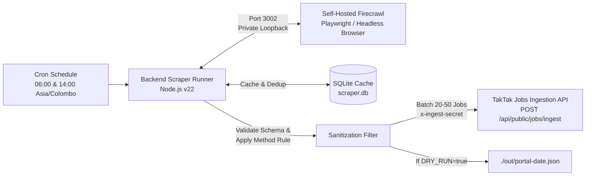

# TakTak Jobs · Self-Hosted Firecrawl Job Scraper & Ingestion Runner

[](#)
[](#)
[](#)
[](#)

> Automated vacancy ingestion pipeline extracting listings from **20 Sri Lankan job boards** and pushing clean, validated JSON into the **TakTak Jobs Ingestion API** twice daily (06:00 & 14:00 Colombo time).

---

## 🏗️ Architecture



---

## 🎯 Target Job Portals (20 Sri Lankan Boards)

1. **TopJobs** (`topjobs.lk`)
2. **XpressJobs** (`xpress.jobs`)
3. **Ikman Jobs** (`ikman.lk/en/ads/sri-lanka/jobs`)
4. **JobEka** (`jobeka.lk`)
5. **Jobpal.lk** (`jobpal.lk`)
6. **Observer Jobs** (`observerjobs.lk`)
7. **Jobfactory** (`jobfactory.lk`)
8. **LankaJobs** (`lankajobs.lk`)
9. **DreamJobs.lk** (`dreamjobs.lk`)
10. **Jobhub.lk** (`jobhub.lk`)
11. **Rooster.jobs** (`rooster.jobs`)
12. **Workstone.lk** (`workstone.lk`)
13. **CareerFirst** (`careerfirst.lk`)
14. **JobsNet** (`jobsnet.lk`)
15. **Everjobs / Guru.lk** (`guru.lk/jobs`)
16. **Sunday Times Classifieds** (`sundaytimes.lk/classifieds`)
17. **Lanka Information Jobs** (`lankainformation.lk/jobs`)
18. **MyJobs.lk** (`myjobs.lk`)
19. **JobsInSriLanka.lk** (`jobsinsrilanka.lk`)
20. **Government Gazette / SL Govt Jobs** (`governmentjobs.lk`)
* *Custom portals dynamically registered via UI / `database/custom_portals.json`*

---

## 📁 Repository Structure

```text
fireCrawl/
├── backend/            # Scraper logic, schema validation, Firecrawl client, TakTak API pusher
├── frontend/           # Minimal React + Vite Status Dashboard (Vercel ready)
├── database/           # SQLite local cache (scraper.db, schema.sql, export_view.json)
├── docker/             # Dockerfile & docker-compose.yml for production deployment
├── out/                # Dry-run output files (JSON batches)
├── index.js            # Main entry point (forwards to backend/index.js)
├── package.json        # Unified scripts (test, dry-run, db:view, docker:up)
├── SETUP_GUIDE.md      # Detailed Hetzner & Vercel deployment guide
└── README.md
```

---

## 📐 Extraction Schema (Section 7)

```typescript
interface ScrapedJob {
  title: string;              // Required, e.g. "Software QA Intern"
  company: string | null;     // e.g. "Silverline Technologies"
  location: string | null;    // e.g. "Colombo", "Kandy", "Remote"
  category: string | null;    // e.g. "IT / Software", "Accounting"
  job_type: string | null;    // Full-time | Part-time | Internship | Contract | Remote
  salary: string | null;      // e.g. "LKR 75,000 - 100,000" or null
  deadline: string | null;    // ISO date (YYYY-MM-DD) or text
  requirements: string | null;// Bullet points, qualifications, skills
  company_summary: string | null;
  raw_text: string | null;    // Full raw text of vacancy
  apply_url: string | null;   // Direct application or portal URL
  apply_email: string | null; // e.g. "careers@example.com"
  apply_whatsapp: string | null; // e.g. "+94771234567"
  source_url: string | null;  // Direct permalink of the listing
}
```

> **Mandatory Rule:** Every saved vacancy must have at least one valid apply method (`apply_url`, `apply_email`, or `apply_whatsapp`). Any listing without an application channel is automatically dropped.

---

## ⚡ Quick Start

### 1. Install & Setup
```bash
# Clone the repository & install
cd fireCrawl
cp .env.example .env
npm install
```

### 2. Run Local Logic & Schema Tests
```bash
npm test
```

### 3. Run Step 1 Dry-Run (TopJobs, XpressJobs, Rooster)
```bash
npm run test-3
```

### 4. Inspect Local SQLite Database
```bash
npm run db:view
```
*(Also check `database/database_export.json` directly in your text editor)*

### 5. Launch Live Status Dashboard
```bash
npm run frontend:dev
```
Open **`http://localhost:5173`** to access the dashboard.

### 6. Run via Docker
```bash
npm run docker:up
npm run docker:logs
```

---

## 🚀 Deployment

Refer to [`SETUP_GUIDE.md`](./SETUP_GUIDE.md) for full Hetzner CX server and Vercel hosting instructions.
